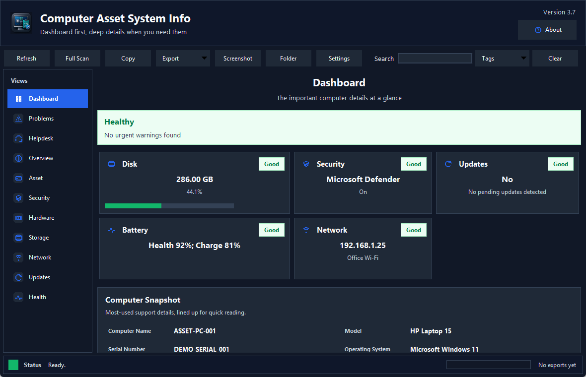
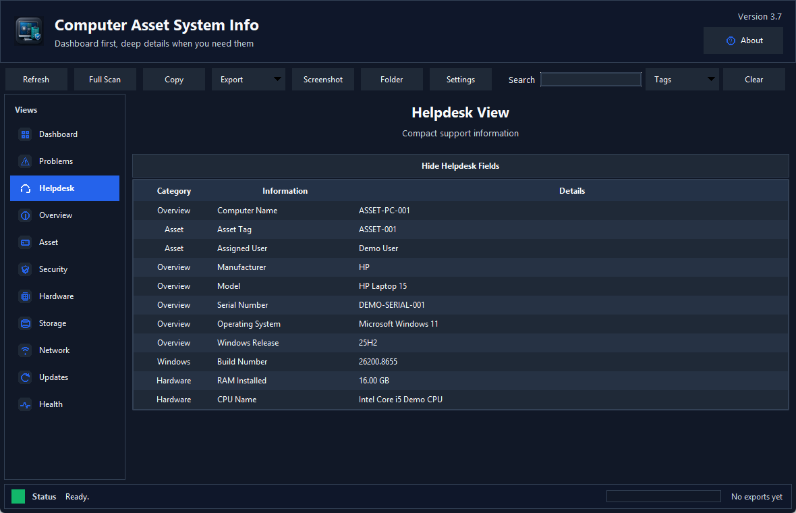
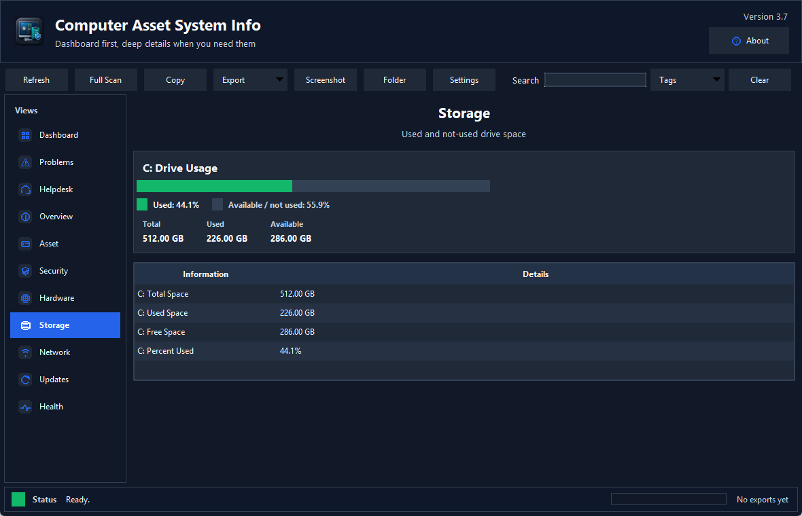
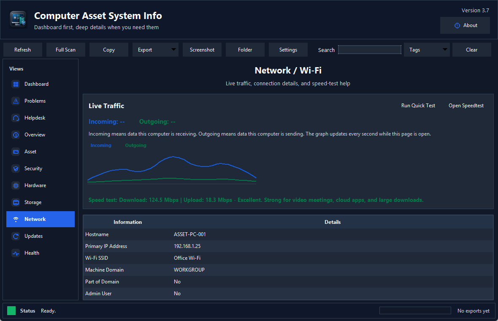

# Computer Asset System Info

Computer Asset System Info is a Windows desktop utility for quickly viewing computer asset, hardware, security, storage, network, Windows Update, and health information in one readable place.

The app is designed for helpdesk, IT support, asset review, and quick troubleshooting. It includes a dashboard, simple navigation tabs, professional exports, screenshot capture, search tags, and a live network view.

## Download

The ready-to-run Windows app is included here:

- `dist/Computer_Asset_System_Info.exe`

The current source file is included here:

- `src/Computer_Asset_System_Info.py`

The original executable that this project started from is included here:

- `original/system_info1_drive_original.exe`

## Features

- Dashboard with disk, security, updates, battery, and network status.
- Helpdesk view with the most commonly requested support details.
- Storage page with visual used and available space.
- Network page with live incoming and outgoing traffic.
- Quick speed test with download, upload, and plain-English rating.
- Security page for Defender, firewall, BitLocker, TPM, Secure Boot, and reboot checks.
- Windows Updates area for update and reboot status.
- Search bar with quick tags such as `wifi`, `speed`, `disk`, `battery`, `security`, `updates`, `hardware`, and `asset`.
- One-click screenshot that saves to Pictures and copies the screenshot to the clipboard.
- Exports to text, CSV, JSON, Excel, and PDF.
- Privacy mode to hide serials, IPs, users, MAC addresses, and other identifiers.

## Screenshots

## GitHub Pages

The website-ready page is in:

- `docs/index.html`

If GitHub Pages is enabled for this repository from the `docs` folder, the project page will show the app description, features, download link, screenshots, and release notes.

## Notes

This is a Windows-only app. Some checks depend on Windows permissions, device management state, WMI, PowerShell, and available Windows services.

The executable is not code-signed. Windows SmartScreen or antivirus tools may warn about unsigned apps, especially when they collect system information. Review the source before running in a managed environment.

